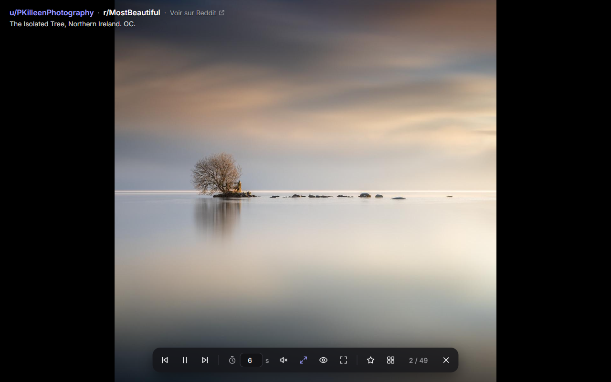
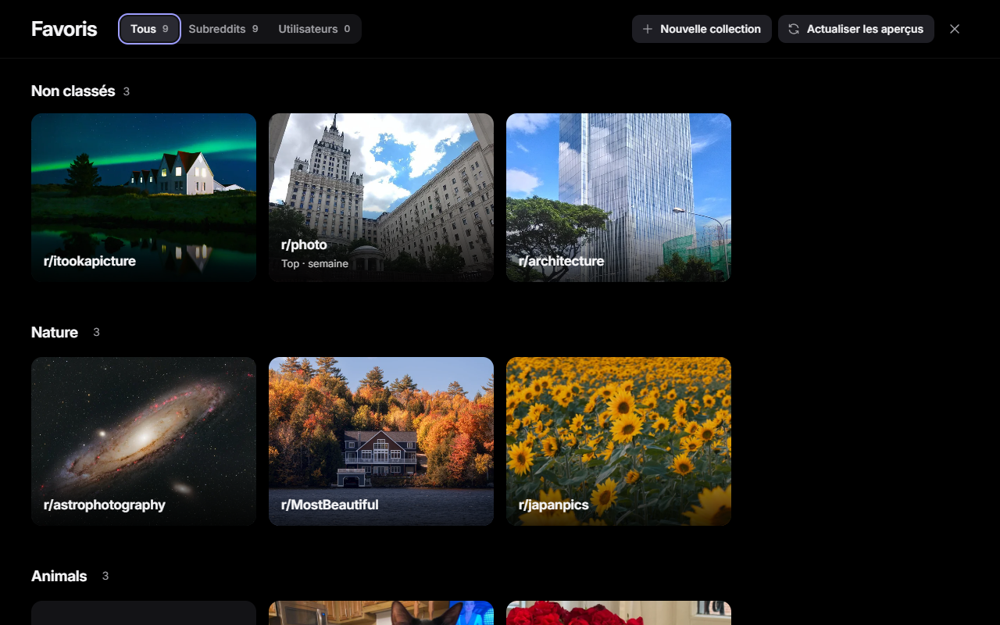
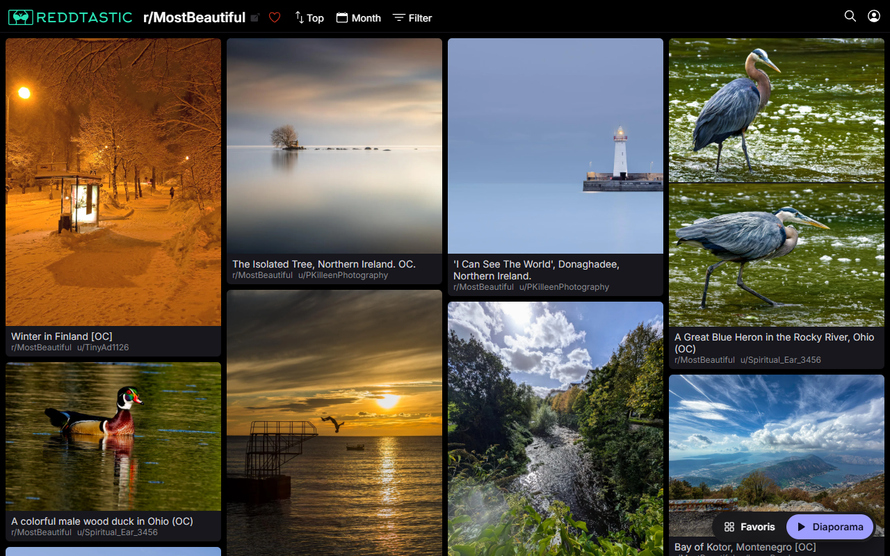

<h1 align="center">Reddtastic Slideshow</h1>

  <b>A fullscreen, auto-advancing slideshow for Reddit — a browser extension for Chrome and Edge.</b> 
  Watch any subreddit or user's photos, videos and galleries hands-free, and keep your favorites in one dashboard.

  
  
  
  
  

  

<a href="README.fr.md">Version française</a>

## Features

- **Fullscreen slideshow** of any subreddit (`/r/…`) or user (`/u/…`) on [reddtastic.com](https://reddtastic.com), following the page's sort (`Hot`, `Top · week`…).
- **Photos, videos and galleries** in the best available quality: original image files, highest-quality video stream, with sound.
- **Favorites dashboard** with daily previews, collections, drag-and-drop and filters.
- **One click from reddit.com**: buttons on any subreddit or user page open the same page as a slideshow.
- **Keyboard first**: every action has a shortcut.
- **Private by design**: no server, no tracking, no analytics. See the [privacy policy](PRIVACY.md).

| Favorites dashboard | One-click launcher |
|---|---|
|  |  |

> The interface is in French for now. An English interface is on the way ([help welcome](https://github.com/HaniWanice/reddtastic-extension/issues)).

## Install

Chrome Web Store and Edge Add-ons listings are coming soon. Until then, install it manually in under a minute:

1. [Download the ZIP](https://github.com/HaniWanice/reddtastic-extension/archive/refs/heads/main.zip) and unzip it.
2. Open `chrome://extensions` (or `edge://extensions`).
3. Turn on **Developer mode**.
4. Click **Load unpacked** and pick the unzipped folder.

## Usage

Open a subreddit or user page on reddtastic.com, or on reddit.com, then click **Diaporama** (slideshow) in the bottom corner. **Favoris** opens your favorites dashboard (`reddtastic.com/#favoris`).

| Key | Action |
|---|---|
| ← / → | previous / next |
| Space | pause / play |
| M | mute / unmute |
| ↑ / ↓ | volume (also mouse wheel, or the slider when hovering the sound button) |
| R | open the post on Reddit |
| U | upscale small photos / actual size |
| H | hide / show controls |
| S | add to / remove from favorites |
| F | fullscreen |
| Esc | close |

Slide duration is adjustable in the toolbar. Videos always play to the end; short videos loop until the slide duration is reached.

## Contributing

Bug reports, ideas and pull requests are welcome.

- **Found a bug?** [Open an issue](https://github.com/HaniWanice/reddtastic-extension/issues/new) with the page URL and what you expected.
- **Want to code?** No build step: edit the files, then click **Reload** on the extension and refresh the tab.
- **Tests:** `node test/media.test.js && node test/favs.test.js && node test/reddit.test.js`

| File | Role |
|---|---|
| `content.js` | slideshow and launcher |
| `home.js` | favorites dashboard |
| `favs.js` | favorites storage, backups, daily previews |
| `media.js` | Reddit post → media list |
| `reddit.js` | buttons on reddit.com |
| `volume.js`, `icons.js` | volume curve, SVG icons |
| `vendor/hls.min.js` | [hls.js](https://github.com/video-dev/hls.js) 1.7.3 (Apache-2.0), for Reddit video sound |

## License

[MIT](LICENSE). hls.js is under the [Apache-2.0 license](vendor/LICENSE-hls.js).

This is an unofficial extension. It is not affiliated with Reddit, Inc. or with reddtastic.com.
